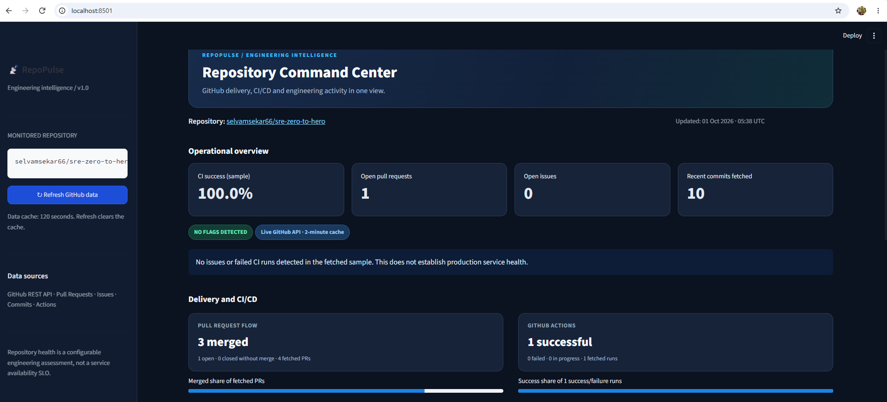
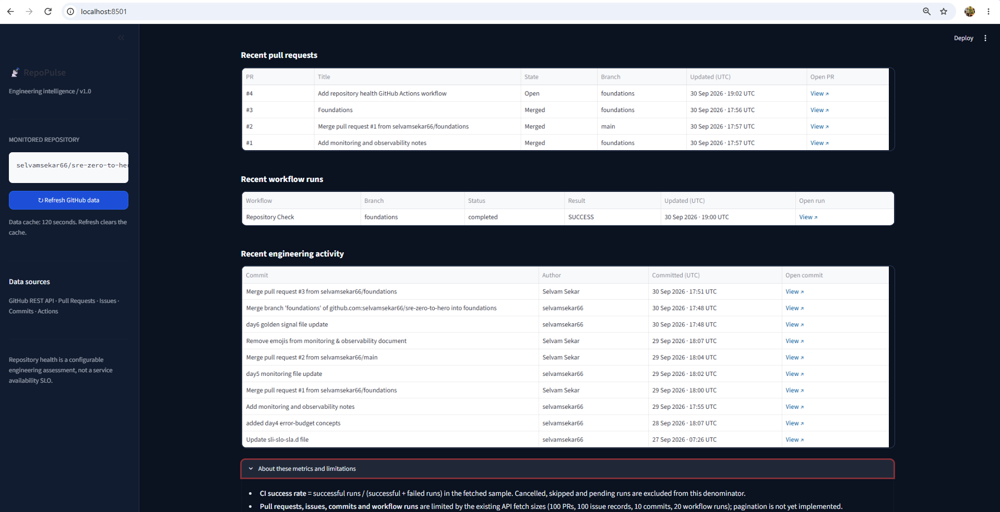

# RepoPulse

## GitHub Repository Engineering Intelligence

RepoPulse is a Python and Streamlit application that uses the GitHub REST API to provide visibility into repository engineering activity, pull requests, issues, commits, and GitHub Actions.

The project was built as a practical learning project to explore GitHub API integration, Python automation, engineering health metrics, and SRE-oriented dashboard design.

---

## Dashboard

RepoPulse provides a centralized view of:

- Repository information
- Pull request activity
- Open pull request aging and time-to-merge
- Issue activity
- GitHub Actions
- CI success rate
- Recent workflow runs
- Recent engineering activity
- Repository engineering signals

## Live Demo

[Open RepoPulse Dashboard](https://repopulse-dashboard.streamlit.app)

### Dashboard Preview



### Engineering Activity


---

## Architecture

```text
GitHub REST API
       |
       v
   config.py
       |
       v
 github_api.py
       |
       +----------------------+
       |                      |
       v                      v
 API Data              Health Calculations
       |                      |
       +----------+-----------+
                  |
                  v
             Streamlit
                  |
                  v
          RepoPulse Dashboard
```

### Technology Stack

- Python
- GitHub REST API
- Requests
- Python-dotenv
- Streamlit
- GitHub Actions

### Features

#### Repository Visibility

- Repository name
- Stars
- Forks
- Default branch

#### Pull Requests

- Total pull requests
- Open pull requests
- Closed pull requests
- Merged pull requests
- Unmerged pull requests
- Open PR age categories and a table of up to 10 oldest open PRs
- Median and P75 PR time-to-merge for valid merges in the trailing 90 days

PR age is calculated from `created_at` to the current UTC time, not from the
last update. Age buckets use completed 24-hour days: 0–2, 3–7, 8–14, and 15+
days. These categories are configurable engineering indicators, not universal
SRE standards or automatic failure signals.

Time-to-merge is `merged_at - created_at`; closed but unmerged PRs and invalid
timestamps are excluded. The median, P75, and valid observation count cover
PRs merged in the trailing 90-day window. GitHub's PR list API is ordered by
recent updates rather than merge time, so RepoPulse checks a bounded sample of
up to 300 open and 300 recently updated closed PRs (three pages of 100 per
state). Counts, oldest-PR results, and merge-time percentiles describe this
sample, not necessarily every PR in the repository. Empty valid merge samples
are shown as unavailable rather than zero. P75 uses linear interpolation
between ordered observations.

#### Issues

- Total issues
- Open issues
- Closed issues

#### GitHub Actions

- Workflow runs
- Successful runs
- Failed runs
- In-progress runs
- CI success rate
- Average, median, and P90 workflow duration
- Recent workflow details including run duration, status, conclusion, and link

Workflow duration is calculated for completed runs from the earliest valid job
start time to the latest valid job completion time in that run. Queued time is
not included. Incomplete runs and runs without valid job time intervals are
excluded. Average and median use the valid duration sample; P90 uses linear
interpolation between ordered observations.

Duration details are requested for at most the 10 most recent workflow runs
shown in the dashboard, and each run's jobs endpoint is paginated up to two
pages of 100 jobs. The run list itself is paginated up to two pages of 20. These
limits keep API usage bounded; metrics describe only the available recent
sample. Workflow duration is separate from CI success rate, which continues to
use successful runs divided by successful plus failed runs in the original
sample of the first 20 recent runs.

#### Engineering Activity

- Recent commits
- Commit author
- Commit timestamp
- Direct GitHub links

### Security

GitHub authentication is handled using a Personal Access Token stored in an environment variable.
The token is never stored in source code.

Example:

```bash
GITHUB_TOKEN=your_token
```

The .env file is excluded from Git using .gitignore.

### Local Setup

1. Clone the repository

```bash
git clone https://github.com/selvamsekar66/github-repo-health.git
cd github-repo-health
```

2. Create a virtual environment

```bash
python -m venv .venv
```

3. Activate the environment

Git Bash:

```bash
source .venv/Scripts/activate
```

4. Install dependencies

```bash
pip install -r requirements.txt
```

5. Configure GitHub authentication

Create a .env file:

```bash
GITHUB_TOKEN=your_github_token
```

6. Run the application

```bash
streamlit run app.py
```

### Run tests

Install application and development/test dependencies, then run:

```bash
pip install -r requirements-dev.txt
pytest -q
```

Open:

```text
http://localhost:8501
```

### Project Structure

```text
github-repo-health/
|
├── .github/
│   └── workflows/
|
├── app.py
├── config.py
├── github_api.py
├── requirements.txt
├── tests/
│   └── test_github_api.py
├── LICENSE
├── README.md
└── .gitignore
```

### Important Note

RepoPulse provides repository-level engineering signals.
It is not an application performance monitoring system and does not represent production service availability or an SLO.
The metrics should be interpreted within the context of the GitHub repository and the data collected by the application.
PR time-to-merge is a repository workflow metric; it is not production lead
time or a DORA metric. This phase does not measure production availability,
production deployment frequency, change failure rate, or recovery time.